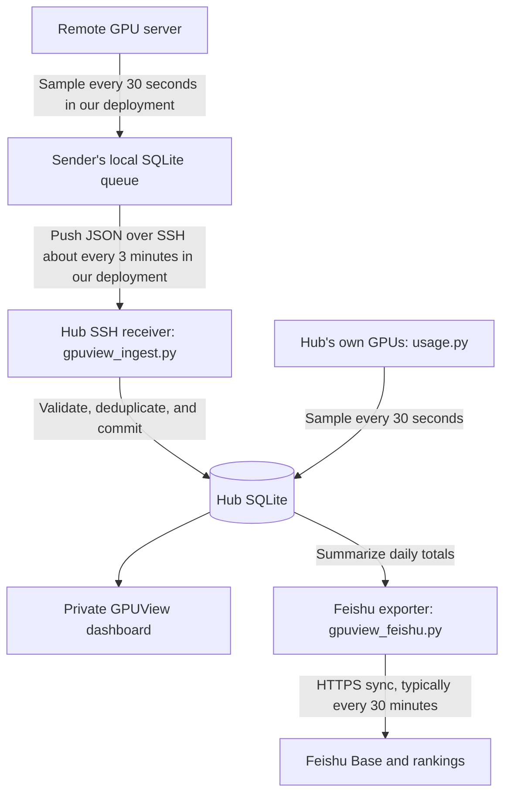

# GPU Tracker

[中文说明](README.zh-CN.md)

Track occupied NVIDIA GPU time and allocated VRAM by Linux account across shared servers. The hub stores samples in SQLite, serves a private GPUView dashboard, and can sync daily totals to Feishu Base.

## How it works

Install the hub on the central server and the sender on each additional GPU server.

| Path | Role |
| --- | --- |
| [`hub/`](hub/) | Local collection, SSH receiver, dashboard, reporting and Feishu export |
| [`sender/`](sender/README.md) | Remote collection, uploads, service installation and tests |
| [Upload protocol](docs/protocol.md) | Shared JSON format, limits and acknowledgment rules |

The root scripts `usage.py`, `gpuview_ingest.py` and `gpuview_feishu.py` are entry points for existing services, SSH keys and scheduled jobs. The hub uses the checkout's `state/` directory.



## Run the hub

On Linux with Python 3.10+ and `nvidia-smi` available, install the dependencies and run the hub as an ordinary user.

```sh
python3 -m venv .venv
.venv/bin/python -m pip install -r requirements.txt
.venv/bin/python usage.py
```

The hub samples every 30 seconds, retains about 31 days of history, and serves HTTP on `state/gpuview.sock`. To open the dashboard from your own computer, forward a local port over SSH. Replace the path and login with those of the hub.

```sh
ssh -N -L 127.0.0.1:9988:/absolute/path/to/gpu_tracker/state/gpuview.sock user@hub
```

Open `http://127.0.0.1:9988/` for the rankings or `/live` for the GPUView dashboard. Run `usage.py` under your usual service manager to keep collecting when you disconnect.

## Enroll a remote sender

On the hub, bind each sender's public key to its own ID using an OpenSSH `authorized_keys` entry with `restrict` and a fixed receiver command. The command runs under the hub database owner's account. Use the absolute checkout path and replace `sender-id` and the example public key.

```text
restrict,command="/usr/bin/python3 -I /absolute/path/to/gpu_tracker/gpuview_ingest.py sender-id" ssh-ed25519 <sender-public-key>
```

On each remote server, follow the [sender setup guide](sender/README.md) to verify the hub's SSH host key and enable uploads. The sender collects every 30 seconds by default and uploads queued intervals every three minutes. Keys, host configuration, logs and usage databases stay in its ignored, private state directory. Only the hub needs Feishu credentials. See the [upload protocol](docs/protocol.md) for the JSON example and retry rules.

## Test the sender

No GPU, SSH access or external Python dependencies are needed for tests, including compatibility with the actual hub receiver:

```sh
python3 -m unittest discover -s sender/tests -t sender -v
```

## Sync to Feishu

Give a Feishu internal app direct edit access to the target Base. In the hub checkout, configure the app interactively, initialize the fields, and verify a test sync.

```sh
.venv/bin/python gpuview_feishu.py --configure 'https://your-team.feishu.cn/base/BASE_TOKEN?table=tblTABLE'
.venv/bin/python gpuview_feishu.py --init-fields
.venv/bin/python gpuview_feishu.py --sync
```

Use the full interpreter and script paths to schedule `--sync` every 30 minutes. The exporter uploads one row per server, Linux account, and calendar day in `Asia/Shanghai`. Feishu can group and sum the daily rows for date-window rankings. GPU-hours measure time spent holding a GPU context, including time when the process is idle.

Optional keys in the owner-only `state/feishu.json` are `server_names`, which maps `local` and remote sender IDs to display names, and `roster_table`, the ID of a table with `服务器`, `Linux 账号`, and `中文姓名` columns. The roster's server labels must match the exported display names.
