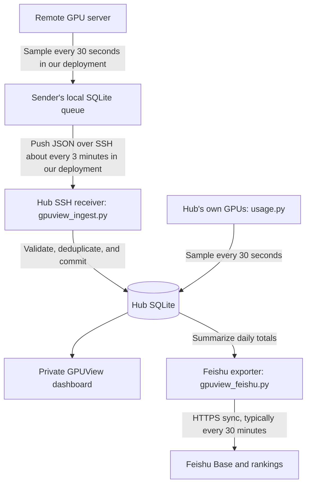

# GPU Tracker

[中文说明](README.zh-CN.md)

Track occupied NVIDIA GPU time and allocated VRAM by Linux account across shared servers. The hub stores samples in SQLite, serves a private GPUView dashboard, and can sync daily totals to Feishu Base.

## How it works

This repository contains the **hub**, including the SSH receiver, local collector, dashboard, and Feishu exporter. The remote sender runs on a separate GPU server and implements the batch protocol below.



## Run the hub

On Linux with Python 3.10+ and `nvidia-smi` available, install the dependencies and run the hub as an ordinary user.

```sh
python3 -m venv .venv
.venv/bin/python -m pip install -r requirements.txt
.venv/bin/python usage.py
```

The hub samples every 30 seconds, retains about 31 days of history, and serves HTTP on `state/gpuview.sock`. To open the dashboard from your own computer, forward a local port over SSH. Replace the path and login with those of the hub.

```sh
ssh -N -L 127.0.0.1:9988:/absolute/path/to/gpu_tracker/state/gpuview.sock user@hub
```

Open `http://127.0.0.1:9988/` for the rankings or `/live` for the GPUView dashboard. Run `usage.py` under your usual service manager to keep collecting when you disconnect.

## Enroll a remote sender

On the hub, bind each sender's public key to its own ID using an OpenSSH `authorized_keys` entry with `restrict` and a fixed receiver command. The command runs under the hub database owner's account. Use the absolute checkout path and replace `sender-id` and the example public key.

```text
restrict,command="/usr/bin/python3 -I /absolute/path/to/gpu_tracker/gpuview_ingest.py sender-id" ssh-ed25519 <sender-public-key>
```

The sender submits a version-1 JSON batch on SSH stdin with up to 100 intervals and a payload limit of 512 KiB. Each interval has `start_utc` and `end_utc` in Unix seconds. Each `users` entry contains `username`, `gpus`, and `memory_mib`. Send an empty `users` list for an idle interval and use `?` if the process owner is unknown.

```json
{
  "version": 1,
  "intervals": [
    {
      "start_utc": 1795536000,
      "end_utc": 1795536030,
      "users": [{"username": "example_user", "gpus": 2, "memory_mib": 40960}]
    }
  ]
}
```

Use actual, recent timestamps and verify the hub's SSH host key. The receiver exits `0` after committing the batch and accepts identical retries. Advance the sender's upload cursor only after success. This repository contains the receiver and its protocol. The sender runs separately.

## Sync to Feishu

Give a Feishu internal app direct edit access to the target Base. In the hub checkout, configure the app interactively, initialize the fields, and verify a test sync.

```sh
.venv/bin/python gpuview_feishu.py --configure 'https://your-team.feishu.cn/base/BASE_TOKEN?table=tblTABLE'
.venv/bin/python gpuview_feishu.py --init-fields
.venv/bin/python gpuview_feishu.py --sync
```

Use the full interpreter and script paths to schedule `--sync` every 30 minutes. The exporter uploads one row per server, Linux account, and calendar day in `Asia/Shanghai`. Feishu can group and sum the daily rows for date-window rankings. GPU-hours measure time spent holding a GPU context, including time when the process is idle.

Optional keys in the owner-only `state/feishu.json` are `server_names`, which maps `local` and remote sender IDs to display names, and `roster_table`, the ID of a table with `服务器`, `Linux 账号`, and `中文姓名` columns. The roster's server labels must match the exported display names.
