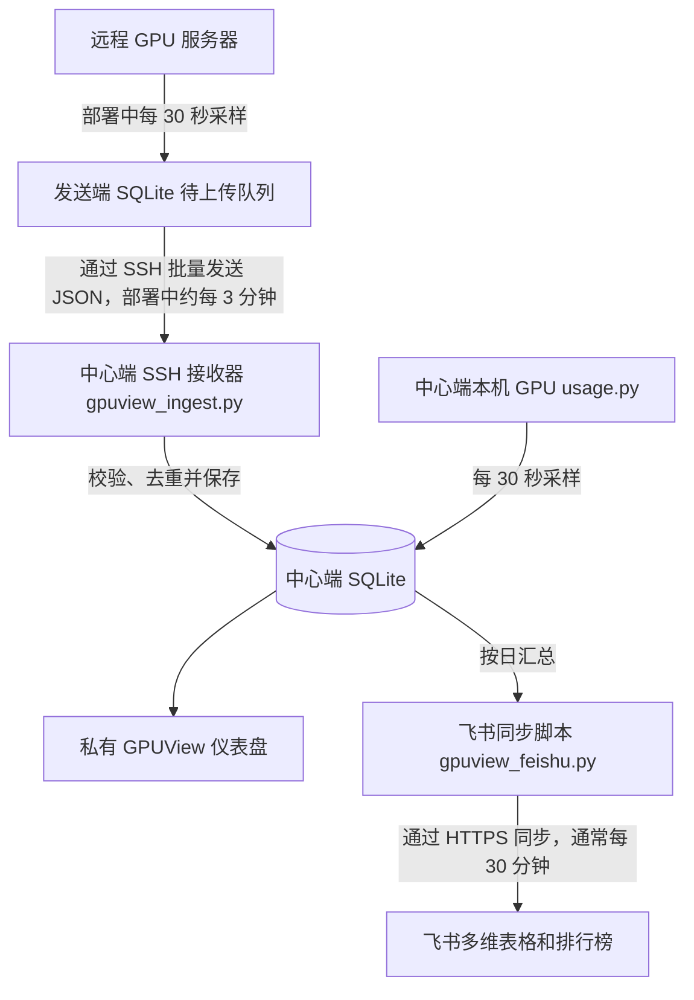

# GPU Tracker

[English README](README.md)

按 Linux 账号记录共享 NVIDIA GPU 服务器上的 GPU 占用时长和显存用量。中心端将采样存入 SQLite，提供私有 GPUView 仪表盘，并可将每日用量同步到飞书多维表格。

## 工作流程

在中央服务器上部署中心端，在其他 GPU 服务器上部署发送端。

| 路径 | 用途 |
| --- | --- |
| [`hub/`](hub/) | 本机采集、SSH 接收、仪表盘、用量汇总和飞书同步 |
| [`sender/`](sender/README.zh-CN.md) | 远程采集、上传、服务安装和测试 |
| [上传协议](docs/protocol.md) | JSON 格式、批次限制和确认规则 |

根目录的 `usage.py`、`gpuview_ingest.py` 和 `gpuview_feishu.py` 供现有服务、SSH 公钥配置和定时任务调用。中心端的数据保存在仓库根目录的 `state/` 中。



## 1. 启动中心端

准备一台装有 Python 3.10 及以上版本、可运行 `nvidia-smi` 的 Linux 服务器。以普通用户安装依赖并启动中心端。

```sh
python3 -m venv .venv
.venv/bin/python -m pip install -r requirements.txt
.venv/bin/python usage.py
```

中心端保留约 31 天的采样记录，通过 `state/gpuview.sock` 提供 HTTP 服务。在自己的电脑上建立 SSH 隧道，将命令中的路径和登录信息替换为实际值。

```sh
ssh -N -L 127.0.0.1:9988:/absolute/path/to/gpu_tracker/state/gpuview.sock user@hub
```

打开 `http://127.0.0.1:9988/` 查看排行榜，或打开 `/live` 查看实时仪表盘。需要持续采集时，可用服务器现有的服务管理工具运行 `usage.py`。

## 2. 接入远程发送端

在中心端的 OpenSSH `authorized_keys` 中，为每台发送服务器添加独立公钥，通过 `restrict` 和固定命令将公钥绑定到唯一的发送端 ID。接收命令以 SQLite 数据库所属的账号运行。替换绝对路径、`sender-id` 和示例公钥。

```text
restrict,command="/usr/bin/python3 -I /absolute/path/to/gpu_tracker/gpuview_ingest.py sender-id" ssh-ed25519 <sender-public-key>
```

按[发送端部署说明](sender/README.zh-CN.md)校验中心端的 SSH 主机密钥并开启上传。发送端默认每 30 秒采集一次，用真实数据验证重复上传后，再开启每 3 分钟上传的用户级 systemd 定时任务。发送端不需要飞书凭据。JSON 示例、批次限制及重试规则见[上传协议](docs/protocol.md)。

无需 GPU、SSH 或外部 Python 依赖即可运行发送端与真实接收器兼容性测试：

```sh
python3 -m unittest discover -s sender/tests -t sender -v
```

## 3. 同步到飞书

给飞书企业自建应用单独授予目标多维表格的编辑权限。在中心端目录下交互式配置应用、初始化字段，并测试同步。

```sh
.venv/bin/python gpuview_feishu.py --configure 'https://your-team.feishu.cn/base/BASE_TOKEN?table=tblTABLE'
.venv/bin/python gpuview_feishu.py --init-fields
.venv/bin/python gpuview_feishu.py --sync
```

定时任务可使用解释器和脚本的绝对路径，每 30 分钟运行一次 `--sync`。同步以北京时间按服务器、Linux 账号和日期写入每日用量。飞书用这些日记录计算不同日期范围的排行。GPU 小时衡量 GPU 被进程占用的时间，也包含持有 GPU 上下文的空闲时间。

`state/feishu.json` 仅供当前用户读取。可选配置 `server_names` 将 `local` 和远程发送端 ID 映射为展示名称。`roster_table` 指定含有 `服务器`、`Linux 账号` 和 `中文姓名` 三列的名册表。名册中的服务器名称应与同步使用的展示名称一致。
